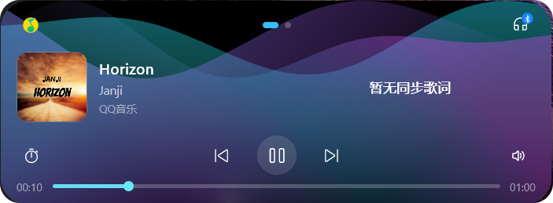
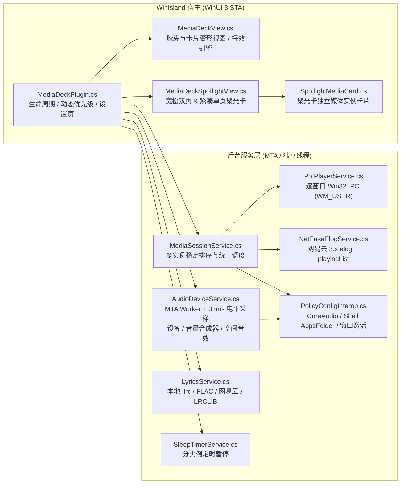

<div align="center">


# 声枢 (MediaDeck)

**面向 [WinIsland (WinLand)](https://github.com/luolangaga/WinLand) 的一站式桌面媒体与音频控制中枢**

[](LICENSE)
[](https://github.com/luolangaga/WinLand)
[](https://dotnet.microsoft.com/)

*多媒体实例管理 · 实时同步歌词 · 音频响应极光波浪 / 专辑轮廓光 · 音量合成器与空间音效 · 分实例定时暂停*

</div>

---

## 目录

- [功能简介](#功能简介)
- [外观演示](#外观演示)
- [动画演示](#动画演示)
- [交互演示](#交互演示)
- [项目架构](#项目架构)
- [适配兼容性](#适配兼容性)
- [安装与构建](#安装与构建)
- [致谢与开源许可](#致谢与开源许可)

---

## 功能简介

**声枢（MediaDeck）** 为 WinIsland 打造了覆盖「胶囊态 → 卡片态 → 聚光卡」三层形态的完整媒体与系统音频体验：

- **三态协同视图**
  - **胶囊态（Compact）**：自动展示当前正在播放（或最近活跃）的媒体封面与同步歌词；超长同步歌词平滑跑马灯滚动（无歌词显示歌名时保持 `……` 省略），右侧实时呈现 5 柱动态波形 / 5 点暂停状态指示器。
  - **卡片态（Expanded）**：支持多实例平滑翻页切换、三行居中同步歌词、可拖拽进度条、左上角来源应用识别与窗口激活、右上角音频输出设备内联快切、控制行左对齐**分实例定时暂停闹钟**与右对齐**喇叭静音 / 悬停弹出垂直音量条**。
  - **聚光卡（Spotlight）**：提供**宽松双页视图（默认）**与**紧凑单页视图**两种布局，集成「音频输出设备」「Windows 音量合成器」「Windows 空间音效」三列独立毛玻璃面板（均附直达 Windows 系统设置入口）以及全部媒体播放实例的完整卡片列表。
- **实时音频响应视觉特效**
  - **极光流光波浪（AuroraWave）**：三层谐波正弦极光带，随左右声道与主音频电平实时流动起伏（通过 WASAPI 音频电平采样，无需麦克风权限），对鼠标指针具备连续平滑的物理流体避让场。
  - **专辑封面轮廓光（AlbumContour）**：提取当前专辑封面多主色，从容器底边向中心柔和投射自下而上渐变光束；支持在设置中自由调节音频律动强度（`0%` 纯静态光 ～ `500%` 强节拍律动），并在自动切歌与点击上/下一曲时触发 780ms 重新染色过渡动画。
  - **鼠标跟随圆形光效**：可选开启以光标为中心的柔和径向光晕，支持自定义开关、光圈大小（默认 `96 px`，可调 `40–320 px`）与透明度（默认 `30%`，可调 `5%–100%`）。
- **系统音频全栈控制**
  - **输出设备快切**：精确区分 HDMI / 显示器、蓝牙耳机（带蓝色蓝牙角标）、有线耳机与扬声器，全量后台缓存实现零卡顿切换。
  - **Windows 音量合成器**：置顶显示「系统声音」，自动过滤 `audiodg` 噪点，展示每个发声程序的真实图标与实时发声波形 / 静音角标，支持独立音量调节与点击图标一键静音。
  - **Windows 空间音效**：与 Windows 11 系统一致，枚举并切换 `关`、`Windows Sonic`、`Dolby Atmos for Speakers / Headphones`、`DTS Headphone:X`。
  - **蓝牙耳机接入提醒**：检测到蓝牙耳机连接时自动弹出岛体横幅提示。
  - **自动暂停**： 一个可靠的通用型自动暂停开关。可按实例设置自动暂停。
  - **转到播放来源**：支持点击卡片左上角媒体来源图标（例如网易云），自动激活对应软件窗口；若窗口已激活，再次单击则闪烁任务栏图标以提醒；若窗口已打开，支持**鼠标双击**或**鼠标中键**媒体来源图标将该窗口收回（最小化）。
- **多语种同步歌词**：支持在「同步歌词设置」中自由勾选「外文歌词显示翻译」与「外文歌词显示音译（罗马音）」，并提供两项胶囊形态专属选项——「胶囊态仅显示歌词翻译」与「允许胶囊态双行显示歌词」（缩小字号并充分利用胶囊上下空间实现双行展示），切换即时生效。
- **智能动态优先级**：支持播放时自动提升优先级占据胶囊，全部暂停超时后自动降低优先级退位让给其他插件，各项优先级与延迟秒数均可自定义。
- **完善的适配**： 深度适配网易云、Potplayer（多开实例）。

---

## 外观演示

### 胶囊态（Compact）

| 专辑封面轮廓光 | 极光流光波浪 |
| :---: | :---: |
|  |  |

_胶囊态优先显示滚动歌词，无歌词或纯音乐时默认仅显示歌曲名_
### 卡片态（Expanded）

| 专辑封面轮廓光 | 极光流光波浪 |
| :---: | :---: |
|  |  |

### 聚光卡（Spotlight）

> 默认采用**宽松双页视图**（每次打开固定回到首页），可在设置中切换为**紧凑单页视图**。

| 宽松视图 · 首页（三列音频控制中心） | 宽松视图 · 第二页（全部媒体播放实例） |
| :---: | :---: |
|  |  |

<details>
<summary>点击展开查看：聚光卡 · 紧凑单页视图（同屏展示音频控制与媒体实例）</summary>
<br />


</details>

---

## 动画演示

> 下方默认展示轻量化 GIF 动图，点击对应链接可查看高清 MP4 原片。

| 胶囊态 · 轮廓光动态效果 | 胶囊态 · 极光波浪动态效果 |
| :---: | :---: |
| <br />[查看高清 MP4 原片](previews/胶囊态-轮廓光效果-动画演示.mp4) | <br />[查看高清 MP4 原片](previews/胶囊态-波浪效果-动画演示.mp4) |

### 卡片态 · 极光波浪与实时播放动画


[查看高清 MP4 原片（卡片态-轮廓光效果播放演示.mp4）](previews/卡片态-轮廓光效果播放演示.mp4)

_注意查看切换卡片实例/切换歌曲时的光效动画_
- **轮廓光切歌重新染色动画**：
  - 胶囊态或自动切歌时，新封面主色以波浪形式**自下而上**柔和重新染色；颜色值从专辑封面取渐变色。
  - 在卡片或聚光卡媒体卡片上点击**上一曲 / 下一曲**时，自动定位被点击按钮的精确坐标，以该按钮为中心向外径向扩散重新染色。

---


[查看高清 MP4 原片（卡片态-波浪效果播放演示.mp4）](previews/卡片态-波浪效果播放演示.mp4)

_注意查看鼠标进入波浪时的避让效果_


---

## 交互演示


[查看高清 MP4 原片（插件的交互设计演示.mp4）](previews/插件的交互设计演示.mp4)

### 交互速览

| 区域 / 控件 | 交互方式 | 行为说明 |
| :--- | :--- | :--- |
| **卡片空白处 / 顶部圆点指示器** | 鼠标滚轮 / 按住左右滑动 / 点击圆点 | 带 240ms 滑入动画切换多个媒体实例 |
| **卡片左上角应用图标** | 单击 / 双击 / 中键 | 单击激活播放器主窗口（若已激活则闪烁任务栏图标提醒，隐藏/关闭时自动拉起）；若窗口已打开，双击或按鼠标中键即可收回（最小化）窗口 |
| **卡片右上角输出设备图标** | 单击 | 卡片内展开可滚动的输出设备切换菜单（不失焦、不越界） |
| **控制行左侧闹钟图标** | 单击 | 为**当前实例**独立设置定时暂停（关闭 / 15 / 30 / 45 / 60 分钟），带无播放状态提醒 |
| **控制行右侧喇叭图标** | 悬停 / 滚轮 / 单击 | 悬停自下而上弹出音量条（支持拖拽与滚轮步进 `2` 调节）；单击切换系统主音量静音 |
| **底部进度条** | 点击 / 拖拽 | 实时拖拽跳转播放进度（不支持外部 Seek 的客户端自动校准本地歌词进度） |
| **聚光卡标题栏（宽松视图）** | 滚轮 / 点击指示器 / 点击翻页按钮 | 在首页（音频控制）与第二页（全部媒体实例）间平滑切换；标题栏下方保持正常列表滚动 |
| **全按钮悬停提示** | 悬停 1000ms | 统一轻微偏移固定显示，离开按钮自动隐藏，避免频繁闪动与遮挡指针 |

---

## 项目架构

声枢严格遵循 WinIsland SDK 2.0 规范：**所有 Core Audio COM 操作完全隔离在后台 MTA 线程**，**所有动效采用 `DispatcherQueueTimer` 逐帧驱动（零 `Storyboard`）**，确保主 UI 线程零阻塞、零 COM 跨套间卡顿。



### 目录结构

```text
MediaDeck/
├── MediaDeckPlugin.cs             # 插件入口：生命周期、动态优先级、事件编排与设置页
├── MediaDeck.csproj               # .NET 10 WinUI 3 类库配置（引用 luolan.winland.Core & NAudio.Wasapi）
├── global.json                    # 锁定 .NET 10 SDK 版本
├── plugin.json                    # WinIsland 插件清单（API v2）
├── Views/
│   ├── MediaDeckView.cs           # 胶囊态/卡片态 IMorphView 变形视图、双特效引擎与交互控件
│   ├── MediaDeckSpotlightView.cs  # 聚光卡（宽松双页 / 紧凑单页、三列音频控制与实例列表）
│   └── SpotlightMediaCard.cs      # 聚光卡内与卡片态 1:1 一致的独立媒体实例卡片
├── Services/
│   ├── MediaSessionService.cs     # 三通道多实例媒体会话汇总、稳定排序与统一控制
│   ├── PotPlayerService.cs        # PotPlayer 原生多实例 Win32 IPC 适配与 FLAC/Shell 封面提取
│   ├── NetEaseElogService.cs      # 网易云音乐 3.x 日志解码、曲目进度与封面获取
│   ├── LyricsService.cs           # 本地 .lrc / FLAC 内嵌歌词 + 在线校验式双源歌词引擎
│   ├── AudioDeviceService.cs      # 独立 MTA 线程音频设备、音量合成器、空间音效与电平采样
│   ├── SleepTimerService.cs       # 分实例独立倒计时定时暂停服务
│   └── PolicyConfigInterop.cs     # CoreAudio COM、Shell AppsFolder 图标解析与跨进程窗口激活
└── previews/                      # 静态截图、GIF 动图与高清 MP4 演示素材
```

---

## 适配兼容性

### 播放器与浏览器兼容矩阵

| 播放器 / 浏览器 | 接入通道 | 标题 / 歌手 | 专辑封面 | 实时进度 / 拖拽 | 同步歌词 | 多实例隔离 |
| :--- | :--- | :---: | :---: | :---: | :---: | :---: |
| **PotPlayer（单开 / 多开）** | 原生 Win32 IPC（绕过 SMTC） | 完整支持 | 完整支持 | 完整支持 | 本地 `.lrc` / FLAC 内嵌优先 | 逐窗口完全隔离 |
| **网易云音乐 3.x** | `cloudmusic.elog` + `playingList` | 完整支持 | 完整支持 | 实时同步（拖拽校准本地歌词） | `songId` 精准直查 | 支持 |
| **Firefox / Zen Browser** | SMTC + Shell `AppsFolder` | 完整支持 | 完整支持 | 完整支持 | 在线校验匹配 | 支持 |
| **Microsoft Edge / Chrome** | SMTC + Shell `AppsFolder` | 完整支持 | 完整支持 | 完整支持 | 在线校验匹配 | 支持 |
| **QQ 音乐 / Spotify / Apple Music / 系统媒体播放器** | SMTC | 完整支持 | 完整支持 | 完整支持 | 在线校验匹配 | 支持 |

### 深度适配技术说明

#### 1. PotPlayer 多实例原生适配
- **痛点**：PotPlayer 多开时，多个窗口共用同一 AUMID 向 Windows SMTC 推送会话，极易引发系统 SMTC 元数据丢失（显示裸 `"PotPlayer"`）、封面串台与控制冲突。
- **方案（[PotPlayerService.cs](Services/PotPlayerService.cs)）**：
  - 自动枚举全部 `PotPlayer64` / `PotPlayer` 顶层窗口句柄（`hWnd`），在后台独立消息线程通过 PotPlayer 官方 `WM_USER` IPC（`0x5006` 状态、`0x5002` 总时长、`0x5004` 当前进度、`0x6020` + `WM_COPYDATA` 获取精确本地文件路径）逐窗口独立读取。
  - 检测到活跃 PotPlayer 窗口时自动接管并忽略冲突的 PotPlayer SMTC 会话；播放/暂停（`0x5007`）、Seek（`0x5005`）、上/下一曲（`WM_COMMAND 10123/10124`）及点击激活窗口均精确作用于对应 `hWnd`。
  - **本地封面与歌词**：直接按该窗口回传的精确文件路径提取 FLAC 内嵌封面 / 同目录封面 / Windows Shell 缩略图，并优先读取同目录 `.lrc`（自动识别 UTF-8 / UTF-16 / GB18030）与 FLAC 内嵌 `LYRICS` 标签，多开任意数量窗口均零串台。

#### 2. 网易云音乐 3.x 无 SMTC 深度适配
- **痛点**：新版网易云音乐桌面端未完整接入 Windows SMTC，常规插件难以准确获取歌名、实时播放状态、封面与精确歌词，直接发系统媒体键还容易误唤醒 QQ 音乐。
- **方案（[NetEaseElogService.cs](Services/NetEaseElogService.cs)）**：
  - 解析本地 `cloudmusic.elog` 日志字节表与 `webdata\file\playingList`，精准提取当前曲目 `songId`、标题、歌手、专辑、封面与播放进度，结合 WASAPI 音频会话实时发声状态交叉校验播放/暂停图标。
  - 歌词直接通过精准 `songId` 查询网易云接口，避免同名翻唱误配；播放控制采用定向全局快捷键，绝不误触其他播放器。

#### 3. 浏览器与多实例稳定排序
- **Firefox / Zen 哈希 AUMID 识别**：通过 Windows Shell `FOLDERID_AppsFolder` + `IShellItemImageFactory` 原生解析 16 位哈希 AUMID，还原真实应用名称与高清图标。
- **SMTC 容错保护**：浏览器 SMTC 偶发瞬态 RPC 抖动时自动重试并保留最近一次有效标题与封面，防止卡片退化为裸浏览器名。
- **确定性多实例排序**：新加入的实例插入首位；某实例从暂停变为播放时与首位交换；胶囊形态在按新旧排序的同时优先展示正在播放的实例。

---

## 安装与构建

### 直接安装（推荐）

1. 确保已安装 **WinIsland (WinLand) ≥ 2.4.0**。
2. 下载发布的 `media-deck.lwp` 插件包。
3. 在 WinIsland 插件管理中导入或直接双击 `.lwp` 文件安装并启用 **声枢**。

### 从源码构建

环境要求：Windows 10/11 (x64)、**.NET 10 SDK**。

```powershell
git clone https://github.com/Starry-AXQG/MediaDeck.git
cd MediaDeck
dotnet build -c Release
```

---

## 致谢与开源许可

- 本项目基于 **[MIT License](LICENSE)** 开源。
- 聚光卡音量合成器与胶囊形态右侧的 **5 柱动态发声波形 / 5 点静音与暂停图标** 设计源自 [wysh3/Zen-Mods - Quietify (`chrome.css`)](https://github.com/wysh3/Zen-Mods/blob/main/Quietify/chrome.css)（MIT License）。
- 网易云音乐 3.x `cloudmusic.elog` 日志解码方案参考自开源社区 [netease-cloudmusic-detector](https://github.com/)（MIT License）。
- 感谢 [WinIsland (WinLand)](https://github.com/luolangaga/WinLand) 提供的插件平台与 SDK 支持。
