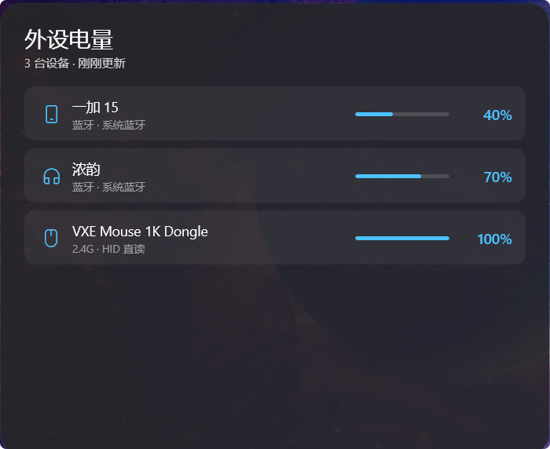
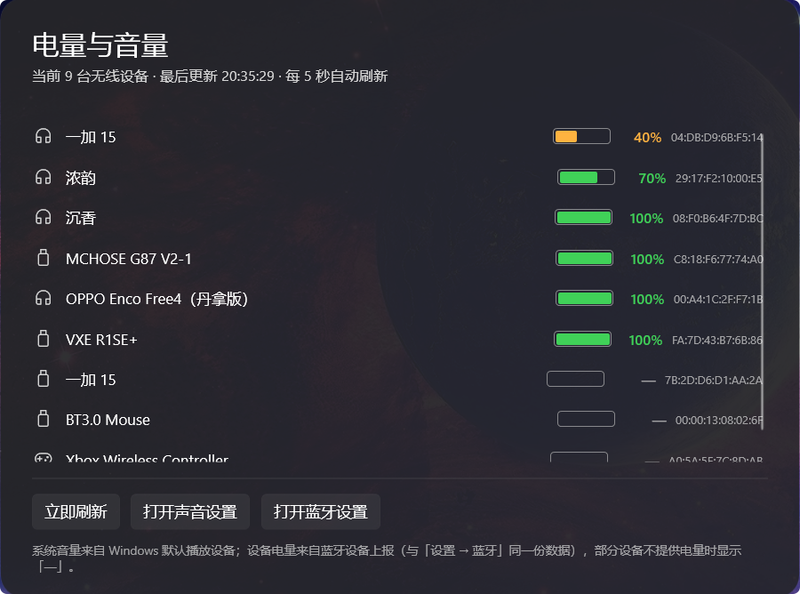
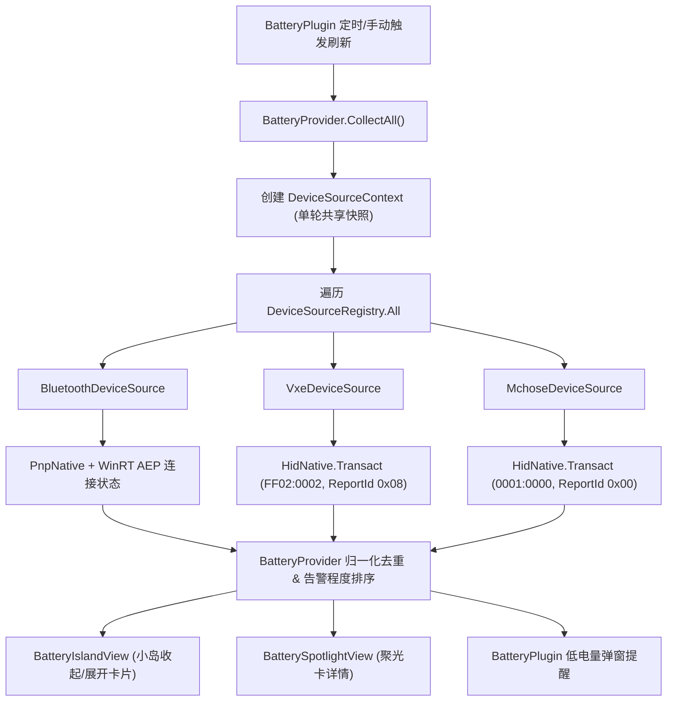
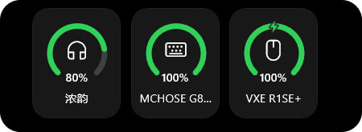
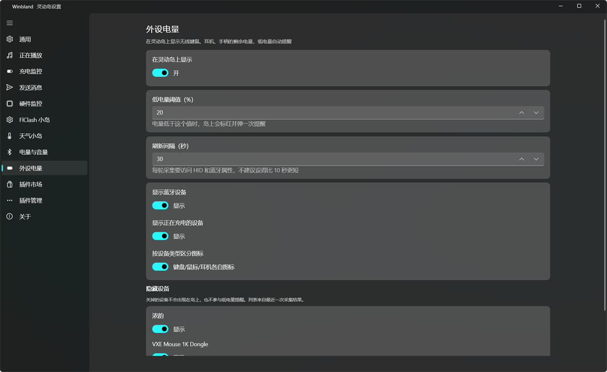

# 外设电量 · WinIsland 插件

在灵动岛上实时显示键盘、鼠标、耳机、手柄、手机的电量与充电状态，低电量时自动提醒充电。

- **设备支持**：支持所有标准蓝牙 / BLE 设备，以及 2.4G 无线外设。目前原生支持 **VXE / ATK（COMPX 方案）** 与 **MCHOSE 迈从（G87 V2 等 GLW 方案）** 2.4G 接收器通过 USB HID 私有协议直读实时电量，无需后台运行官方驱动。同时支持用户使用 AI Agent 快速逆向并添加新品牌适配，欢迎提交 PR。
- **按告急程度排序**：设备列表默认按「电量告急程度」升序排列，越需要充电的设备排在越上方；卡片高度随设备数量自适应，并在上限内与同屏插件保持对齐。
- **精准设备类型与图标**：蓝牙设备优先解析系统 `Class of Device (CoD)` 主次类别位段，2.4G 设备结合协议通道与产品名识别，准确区分键盘、鼠标、耳机、手柄、手机。
- **灵活过滤与隐藏**：自动过滤已配对但未开机/休眠的蓝牙与 2.4G 设备；设置页支持按单台设备隐藏，或一键隐藏正在充电的设备。

预览：



*点击岛体弹出的聚光卡：逐行列出设备名、通道标签（蓝牙 / 2.4G · HID 直读）与实时电量百分比。*

---

## 为什么选这个，而不是「电量与音量」

社区里已有的 [`bluetooth-battery`（市场名「电量与音量」）](https://github.com/luolangaga/WinLandPlugin/tree/main/plugins/bluetooth-battery) 仅覆盖蓝牙，且存在图标误判、离线设备常驻显示 100% 等问题。本插件针对这些痛点做了全面重构：

### 1. 图标丰富，设备类型识别准确

`bluetooth-battery` 仅按设备名猜测类型，遇到中文自定义昵称（如本机的「浓韵」「沉香」两台头戴耳机）就会退回通用图标。

本插件优先读取蓝牙 **Class of Device**（系统配对时记录的硬件类别），名称仅作兜底：

| CoD Major | 含义 | 判定 |
| --- | --- | --- |
| 4 | Audio/Video | 耳机 |
| 2 | Phone | 手机 |
| 5 | Peripheral | 解析 Minor 位段：键盘 / 鼠标 / 键鼠一体 / 手柄 |

Peripheral 的 Minor 必须**按位段提取**（`minor & 0x30` 表示指点/键盘类别，低 4 位表示手柄/摇杆），修正后中文昵称耳机与 Xbox 手柄均可精准匹配对应图标。无法归类的外设统一使用**电池图标**而非电脑图标，避免误导。

### 2. 原生支持 2.4G 设备 USB HID 私有协议直读，且易于扩展

Windows 的标准 PnP 电池属性不包含 2.4G 接收器：2.4G 键鼠/耳机全部通过厂商自定义的 USB HID 报文通信。

本插件通过逆向厂商官方 WebHID 网页驱动与客户端，实现了**无需后台常驻官方驱动**的 USB HID 实时直读架构，并封装了通用的异步超时 HID 事务层 `HidNative.Transact`。新增一个品牌只需在 `Sources/Devices/` 下新增一个实现类并在注册表登记一行。

### 3. 严谨的在线状态过滤与多通道去重

- **同名多通道自动合并**：同一台三模键鼠既插着 2.4G 接收器又配对过蓝牙时，插件会将设备名称归一化（剥离 `2.4G`、`-1` 等后缀）后合并，并按「`2.4G HID 直读 > 蓝牙 LE > 经典蓝牙`」的优先级保留最准确的一条。
- **剔除未开机/休眠设备**：
  - **蓝牙侧**：结合 WinRT AEP 的 `System.Devices.Aep.IsConnected` 属性（即 Windows 设置中判断「已连接」的底层标志），按 `macConnected || nameConnected` 过滤掉配对过但未开机的设备。
  - **2.4G 侧**：仅插着 USB 接收器而无线键鼠关机/深度休眠时，通过协议层的在线查询帧（如 VXE 的 `cmd 0x03`）或停止通信帧（如迈从 GLW 的 `0xFA 0xFB 0x06 0x00`）精准识别离线状态，绝不显示假电量。

对比市场上 `bluetooth-battery` 的显示效果：



*同一台机器上「电量与音量」的列表：9 台里有 5 台根本没开机，全部固定显示 100%，右侧还残留 MAC 地址。*

### 4. 支持按设备单独隐藏

设置页会列出最近一次扫描到的所有外设，每台设备都有独立开关。被关闭的设备不会出现在灵动岛上，也不会触发低电量提醒，并支持「全部恢复显示」一键重置。

---

## 项目架构

项目采用「**宿主生命周期层 → 采集编排与去重层 → 可插拔数据源层 → Win32/WinRT 原生互操作层 → 灵动岛视图层**」的五层解耦架构：

```text
peripheral-battery/
├── PeripheralBattery.csproj          项目配置与构建后自动部署到 WinIsland 插件目录的目标
├── plugin.json                       WinIsland 插件清单（ID、版本、入口类型、默认尺寸与优先级）
├── rebuild.ps1                       一键停止宿主、强制 Rebuild、独立进程重启宿主并查看日志脚本
├── Native/                           【原生互操作层】封装 Win32 P/Invoke 与 SetupAPI / HID 通信
│   ├── HidNative.cs                  HID 接口枚举、Feature 读取、Overlapped 异步读写事务（Transact）
│   └── PnpNative.cs                  SetupDi 设备树遍历与 DEVPKEY 强类型属性读取（蓝牙电量、CoD 等）
└── Sources/
    ├── BatteryPlugin.cs              【插件入口与生命周期】定时调度、低电量提醒、设置面板 UI 构建
    ├── PluginSettings.cs             【配置持久化】封装宿主 IPluginSettings（阈值、周期、隐藏设备集）
    ├── BatteryProvider.cs            【采集编排与去重管线】调度所有数据源、归一化设备名、跨通道优先级合并
    ├── DeviceBattery.cs              【领域模型】统一表示外设电量、充电态、外设类型、连接方式与图标映射
    ├── BatteryIslandView.cs          【灵动岛主视图】收起态单行最告急设备 + 展开态自适应高度多行列表
    ├── BatterySpotlightView.cs       【聚光卡视图】点击岛体弹出的完整设备详情面板与手动刷新入口
    └── Devices/                      【可插拔数据源层】每种连接方式或 2.4G 品牌独立实现 IDeviceSource
        ├── IDeviceSource.cs          数据源统一接口（Brand + Collect）
        ├── DeviceSourceContext.cs    单轮采集共享快照（按需惰性枚举的 HID 接口表、蓝牙 AEP 状态、日志）
        ├── DeviceSourceRegistry.cs   数据源注册表（按顺序注册 Bluetooth / VXE / MCHOSE 等数据源）
        ├── BluetoothDeviceSource.cs  蓝牙 / BLE 数据源（PnP 电池属性 + WinRT AEP 在线过滤 + CoD 类型识别）
        ├── VxeDeviceSource.cs        VXE / ATK 2.4G 数据源（COMPX 17 字节 HID 协议直读）
        └── MchoseDeviceSource.cs     MCHOSE 迈从 2.4G 数据源（GLW 65 字节 HID 协议直读 + HUB 缓存兜底）
```

### 核心数据流与模块协作



各模块的关键设计职责：

1. **`Native/HidNative.cs`（通用 HID 事务引擎）**：
   - `Enumerate()`：通过 `SetupDiGetClassDevs` + `HidP_GetCaps` 一次性枚举本机所有 HID 集合的 `Path`、`VendorId`、`ProductId`、`UsagePage`、`Usage`、`InputLength`、`OutputLength`、`FeatureLength` 与 `ProductName`。
   - `Transact()`：针对 2.4G 接收器的 Input/Output 双向协议，以 `FILE_FLAG_OVERLAPPED` 打开设备句柄，发送 Output Report 后循环异步 `ReadFile`，支持通过谓词 `Func<byte[], bool> match` 过滤掉心跳杂帧，并在超时时调用 `CancelIoEx` 安全取消，彻底杜绝因无线设备休眠不回包而卡死后台线程。
2. **`Sources/Devices/DeviceSourceContext.cs`（单轮采集共享快照）**：
   - 采用 `Lazy<IReadOnlyList<HidNative.HidInterface>>` 缓存当轮 HID 枚举结果：无论接入多少个 2.4G 品牌数据源，每轮刷新只做一次底层系统 HID 枚举。
3. **`Sources/BatteryProvider.cs`（多源容错与跨通道去重）**：
   - 每个 `IDeviceSource` 独立 `try/catch` 执行，单个驱动或设备异常绝不波及其他外设；
   - 对采集到的全部设备按归一化名称（剥离 `2.4G`、`Wireless`、蓝牙配对序号 `-1` 等）分组，同一物理设备同时存在 2.4G 与蓝牙记录时优先保留 2.4G 实时直读结果。
4. **`Sources/BatteryIslandView.cs`（自适应高度与布局对齐）**：
   - 收起态展示最告急的 1 台设备；悬停展开态复用同一套 `DeviceRow` 布局，并根据实际可见设备数量动态计算 `DesiredExpandedHeight`（上限 `152 DIP`，与官方「硬件监控」插件严丝合缝对齐）。

---

## 显示逻辑

- **收起状态**：显示当前电量最告急的那一台（类型图标 + 名称 + 迷你电量条 + 百分比）
- **悬停展开**：在卡片高度上限（`152 DIP`，最多 4 台）内按电量告急程度从高到低排列
- **点击岛体**：打开聚光卡，查看全部在线外设的完整列表、来源通道与刷新按钮



---

## 数据来源与已支持设备

| 品牌 / 类别 | 型号 / 范围 | VID : PID | 协议通道与读取方式 |
| --- | --- | --- | --- |
| **蓝牙 / BLE** | 任意蓝牙耳机 / 手机 / 手柄 / 键鼠 | 任意 | Windows PnP 电池属性 `{104EA319-6EE2-4701-BD47-8DDBF425BBE5} 2` + WinRT AEP 在线过滤 |
| **VXE / ATK** | Mouse 1K Dongle（R1SE+ 等 COMPX 接收器） | `3554:F58E` / `373B:*` | HID `UsagePage 0xFF02, Usage 0x0002`（17 字节 COMPX 协议，ReportId `0x08`：`cmd 0x03` 判在线 + `cmd 0x04` 直读电量/充电/电压） |
| **MCHOSE 迈从** | G87 V2 等 GLW 方案 2.4G 键盘接收器 | `3837:3033` / `41E4:*` | HID `UsagePage 0x0001, Usage 0x0000`（65 字节 GLW 协议，ReportId `0x00`，`flag 0x55`，`cmd 0x05 getFuncConfig` 直读电量/充电/模式；非 GLW 旧设备回退 HUB 缓存） |

---

## 新增一个 2.4G 品牌支持（逆向与接入实战指南）

> **给用户**：如果你的 2.4G 无线鼠标、键盘或耳机不在上述适配列表中，只需把下方「[给 Agent 的逆向与适配任务提示词](#给-agent-的逆向与适配任务提示词)」复制给你的 AI Agent（如 Antigravity / Claude Code / Cursor），并提供该设备的**网页驱动网址**（或本机已安装的客户端路径），Agent 即可自动完成协议逆向、真机报文验证、代码接入与重载测试。也欢迎验证通过后提交 PR！

### 一、从 VXE 与 MCHOSE 逆向中总结的核心经验

在重构 VXE 和 MCHOSE 2.4G 电量获取逻辑的过程中，我们踩过并排除了两个极具代表性的误区。理解这些规律能帮你和 Agent 少走 90% 的弯路：

#### 误区 1：盲扫 `HidD_GetFeature` 把静态固件常量当成 100% 电量
- **案例（VXE 1K Dongle）**：接收器在 `UsagePage 0xFF04` 上暴露了一条 8 字节 Feature Report（`ReportId = 0x06`），读取总是返回 `06 FF 00 64 64 64 A9 97`。旧逻辑误以为 `byte[3] = 0x64 (100)` 是电量，导致鼠标明明只剩 30% 却永远显示 100%。
- **真相**：逆向 ATK Hub 网页驱动后发现，`0xFF04` 返回的只是接收器固件静态配置与 RF 地址（`A9-97-D3`），`0x64` 是固定常数。真正的通信走的是 **`UsagePage 0xFF02, Usage 0x0002`** 上的 17 字节 Output/Input Report（`ReportId = 0x08`），且需要先发 `cmd 0x03` 查在线状态，再发 `cmd 0x04` 才能拿到真实电量（`30%`）和电池电压（`3682mV`）。

#### 误区 2：没加私有帧头和校验和，误以为“官方驱动独占了设备”
- **案例（MCHOSE G87 V2）**：直接向接收器的 `0x0001` / `0xFF31` / `0xFF70` 通道裸发 Report 全部无响应，加上 `MCHOSE HUB` 运行时本地配置文件 `mc_main_store_key.json` 长期不更新，旧逻辑误判为“驱动独占了 HID 接口，只能读 JSON 缓存”。
- **真相**：
  1. 逆向迈从网页驱动（`GLWDeviceSDK`）发现，键盘接收器要求在 `UsagePage 0x0001, Usage 0x0000` 上发送 65 字节帧，且**必须带有 `tx[1] = 0x55` 协议头和 `tx[4] = sum(tx[5..8]) & 0xFF` 校验和**。只要报文合法，即使 `MCHOSE HUB.exe` 正在后台运行，插件也能随时共存直读实时电量！
  2. 为什么 `mc_main_store_key.json` 不更新？逆向客户端 Electron 源码发现，`trayService.syncDeviceList` 调用的是 `ipcRenderer.invoke("setStore", "webIndexList", data, false)`——第 4 个参数 `persistent = false` 表示**只更新内存和 Chromium LevelDB LocalStorage，不落盘写入 JSON 文件**。

---

### 二、2.4G 外设协议逆向标准五步法

现在绝大多数国产/主流外设（VXE、ATK、迈从 MCHOSE、狼蛛、VGN、雷柏、达尔优、Keychron 等）都提供了基于浏览器 **WebHID API** 的网页驱动，或基于 **Electron** 的桌面驱动。这意味着它们的完整 HID 协议全部以 JavaScript 明文（或混淆后的 JS Bundle）存在！

#### 第 1 步：枚举本机 HID 接口树，锁定目标接收器通道
插上 2.4G 接收器并打开外设电源。枚举本机 HID 接口，列出目标品牌 `VID/PID` 下的所有接口（一个接收器通常会暴露 4~8 个接口）：
- 排除标准键鼠集合（`UsagePage 0x0001` + `Usage 0x0002` 鼠标 / `0x0006` 键盘，或 `UsagePage 0x000C` 消费类控制）。
- 重点关注 **`InputLength > 0` 且 `OutputLength > 0`**（或 `FeatureLength > 0`）的厂商通道，常见如：
  - `UsagePage 0xFF00 ~ 0xFFFF`（如 VXE COMPX 的 `0xFF02:0002`，Report 长度 `17`）；
  - `UsagePage 0x0001, Usage 0x0000`（如迈从 GLW 的 `0x0001:0000`，Report 长度 `65`）。

#### 第 2 步：从网页驱动或客户端 JS Bundle 中提取 WebHID 协议
- **若有网页驱动（首选）**：
  1. 获取网页驱动首页 HTML 及引用的 `.js` 资源列表；
  2. 注意许多多方案网页驱动（如迈从、ATK）会按芯片方案动态加载子模块（例如搜索 `SHARED_DATA`、`compx`、`nordic`、`telink`、`royuan` 等关键字找到真正的设备 SDK chunk）。
- **若有本地客户端（通常为 Electron）**：
  1. 检查安装目录下的 `resources/app` 或 `resources/app.asar`；
  2. 直接检索其中的 `out/main`、`out/preload`、`out/renderer` 下的 JS 文件。
- **大文件高速检索技巧（避坑）**：
  - 压缩后的单行 JS 文件动辄 5MB~10MB，**切勿使用带前置通配符的正则（如 `.{0,500}battery`）**，会导致严重回溯卡死。
  - 应使用 `String.IndexOf("关键字")` 定位偏移量后，再用 `.Substring(Math.Max(0, idx - 300), 800)` 提取上下文。
  - **核心搜索锚点**：`sendReport`、`sendFeatureReport`、`oninputreport`、`usagePage`、`battery`、`BatteryLevel`、`charge`、`work_mode`、`checkSum`。

#### 第 3 步：还原帧结构、校验和与「休眠/离线判据」
从 JS 代码中还原出完整的请求与响应规范：
1. **Report ID 与帧长**：注意 WebHID 的 `device.sendReport(reportId, data)` 会把 `reportId` 与 `data` 分开传，而 Windows `WriteFile` / `ReadFile` 要求把 **`ReportId` 放在 `buffer[0]`**（因此 WebHID 中长度为 16 的 `data` 加上 `ReportId 0x08`，在 Win32 中总长度为 `17` 字节；WebHID 中 `reportId = 0` + 64 字节数组，在 Win32 中总长度为 `65` 字节，且所有下标向后偏移 1 位）。
2. **帧头与校验和**：
   - 如 VXE COMPX：`tx[0] = 0x08`，`tx[1] = cmd`，`tx[16] = (0x55 - ((0x08 + sum(tx[1..15])) & 0xFF)) & 0xFF`。
   - 如迈从 GLW：`tx[0] = 0x00`，`tx[1] = 0x55`，`tx[2] = cmd`，`tx[4] = (tx[5] + tx[6] + tx[7] + tx[8]) & 0xFF`。
3. **休眠/离线判据与「省电休眠电量保持」机制（极其重要）**：
   - 2.4G 接收器一直插在电脑上，而无线鼠标/键盘通常静止几十秒就会进入一级省电休眠（如 VXE 返回 `onlineStatus = 0`；迈从 GLW 返回 `00 FA FB 06 00` 停止通信帧）。
   - 如果一检测到休眠就直接丢弃设备，会导致鼠标/键盘一停手就从灵动岛列表消失，一移动又跳出来。
   - **正确做法**：在 `DeviceSource` 内按接收器 `(VID, PID)` 维护最近一次唤醒态读到的有效电量快照（`_lastKnownByProduct`）：
     - 只要接收器仍插在 USB 口上，当设备处于省电休眠态且已有历史电量快照时，**继续沿用休眠前的最后一次有效电量**；若冷启动时设备尚未唤醒（无历史快照），则跳过不显示假电量；
     - 一旦接收器从 USB 口拔出，立即清除对应缓存，设备立刻从列表移除。

#### 第 4 步：使用内存 P/Invoke 脚本对实机发包验证
在正式修改插件源码前，用 PowerShell `Add-Type` 编译一小段内联 C#（无需在磁盘创建任何临时文件），直接向实机 HID 路径发送构造好的请求帧并打印返回的 Hex 字节流，确认：
- 读出的电量百分比与官方网页驱动/客户端显示的数值完全一致；
- 插拔充电线时，充电标志位能正确变化；
- 关掉外设电源时，能正确触发离线/休眠分支。

#### 第 5 步：实现 `IDeviceSource`、注册并重载验证
1. 在 `Sources/Devices/` 下创建 `<Brand>DeviceSource.cs`，调用 `Native.HidNative.Transact(hid.Path, request, responseLen, matchPredicate, timeoutMs)` 完成通信；
2. 在 `Sources/Devices/DeviceSourceRegistry.cs` 的 `All` 数组中注册该数据源；
3. 运行 `.\rebuild.ps1` 完成强制重编译与 WinIsland 重启，检查 `%LOCALAPPDATA%\WinIsland\logs\plugin.peripheral-battery.log`。

---

### 三、给 Agent 的逆向与适配任务提示词

你可以将以下提示词直接复制给 Agent，填上你的设备名称和网页驱动地址：

```text
任务：为 WinIsland「外设电量」插件（peripheral-battery）逆向并新增一个 2.4G 外设品牌支持。

待适配设备：<填写设备品牌与型号，例如：XXX 无线鼠标 / 键盘>
官方网页驱动地址（或本地客户端路径）：<填写网页驱动 URL，如 https://... 或客户端安装路径>
项目根目录：<peripheral-battery 的路径>

请先阅读以下项目文件理解现有架构：
  - README.md（重点阅读「项目架构」与「新增一个 2.4G 品牌支持」章节的逆向五步法）
  - Native/HidNative.cs（特别是 Enumerate 与 Transact 方法）
  - Sources/Devices/IDeviceSource.cs
  - Sources/Devices/DeviceSourceContext.cs
  - Sources/Devices/DeviceSourceRegistry.cs
  - Sources/Devices/VxeDeviceSource.cs（范例 1：17 字节 COMPX 协议，先查在线状态 cmd 0x03 再查电量 cmd 0x04）
  - Sources/Devices/MchoseDeviceSource.cs（范例 2：65 字节 GLW 协议 cmd 0x05 + 休眠帧 FA FB 06 00 识别）

请严格按以下五个步骤执行，每一步都要有实测证据：

【第 1 步 · 枚举本机 HID 接口树】
在内存中通过 PowerShell Add-Type 或现成工具枚举本机 HID 接口，找出目标设备接收器的 VID / PID，
以及它暴露的所有 UsagePage / Usage / InputLength / OutputLength / FeatureLength / ProductName。

【第 2 步 · 逆向网页驱动 / 客户端提取 HID 协议】
抓取目标网页驱动的前端 JS Bundle（注意排查按芯片方案动态加载的子 chunk），或检查本地 Electron 客户端的 JS 代码。
检索 sendReport / sendFeatureReport / oninputreport / usagePage / battery / charge 等关键字（对单行大 JS 文件请使用 IndexOf + Substring，切勿使用带前置通配符的正则以防回溯卡死）。
准确还原出：
  1. 通信使用的 UsagePage、Usage 与 ReportId；
  2. 请求帧字节长度、帧头魔数、命令号、校验和算法；
  3. 响应帧的匹配条件、电量百分比所在字节/位段、充电状态所在字节/位段；
  4. 无线设备关机或休眠时的在线状态查询命令或离线响应帧格式。
（注：谨记 WebHID 的 sendReport(reportId, data) 在 Win32 WriteFile/ReadFile 中对应 buffer[0] = reportId，data 从 buffer[1] 开始，注意核对 1 字节的下标偏移！）

【第 3 步 · 真机发包实测】
在不写入外部临时文件的前提下，用 PowerShell 内存 C# 脚本向步骤 1 找到的 HID 接口发送步骤 2 还原的报文，
打印原始响应 Hex 并解析电量、充电状态和在线状态，与设备当前真实电量交叉核对。

【第 4 步 · 编写数据源并注册】
1. 在 Sources/Devices/ 下新建 <Brand>DeviceSource.cs，实现 IDeviceSource：
   - 使用 Native.HidNative.Transact 发送请求并过滤响应帧，设置合理超时（250~300ms）；
   - 按 (VID, PID) 维护休眠态电量保持缓存（参照 VxeDeviceSource._lastKnownByProduct）：接收器在位且外设进入省电休眠时沿用休眠前最后一次有效电量，防止静止时从列表闪烁消失；接收器拔出时立即清除缓存；冷启动未唤醒且无历史快照时返回空；
   - 电量越界（<=0 或 >100）跳过；
   - Name 去除尾部的 " 2.4G" 等连接方式后缀，以便与同设备的蓝牙通道去重合并；
   - Collect 方法绝不向外抛异常。
2. 在 Sources/Devices/DeviceSourceRegistry.cs 的 All 数组中登记新数据源。
3. 在 README.md 的「数据来源与已支持设备」表格中补充该设备的 VID:PID 与协议说明。

【第 5 步 · 编译、重启 WinIsland 与日志验证】
在项目根目录下执行：
  powershell.exe -NoProfile -ExecutionPolicy Bypass -File .\rebuild.ps1
检查 %LOCALAPPDATA%\WinIsland\logs\plugin.peripheral-battery.log，确认日志中出现：
  "· <设备名> = <真实电量>%（2.4G / HID 直读）"
且无任何异常报错。
```

---

## 设置项

设置页位于「WinIsland 设置 → 外设电量」：



- **在灵动岛上显示**：总开关
- **低电量阈值（%）**：默认 `20%`，低于此值时标红并弹出一次低电量提醒
- **刷新间隔（秒）**：默认 `30` 秒
- **显示蓝牙设备**：开启/隐藏所有蓝牙通道外设
- **显示正在充电的设备**：默认开启，关闭后充电中的设备不占用岛体空间
- **按设备类型区分图标**：键盘/鼠标/耳机/手柄/手机各自独立图标或统一图标
- **隐藏设备**：按单台设备独立开关显示状态，支持「全部恢复显示」与「重新扫描设备列表」
- **立即刷新 / 发一条测试提醒**：快捷调试按钮

---

## 构建与调试

### 编译与自动部署

必须在插件项目根目录下执行（确保 `global.json` 锁定 `.NET 10.0.x` SDK），且必须带 `-t:Rebuild`：

```powershell
$env:DOTNET_ROOT = "$env:USERPROFILE\.dotnet"
& "$env:USERPROFILE\.dotnet\dotnet.exe" build -c Release -t:Rebuild
```

或者直接运行根目录下的 `rebuild.ps1`（会自动停止 WinIsland 释放 DLL 文件锁、执行强制 Rebuild、以独立进程重启 WinIsland 并输出最新插件日志）：

```powershell
powershell.exe -NoProfile -ExecutionPolicy Bypass -File .\rebuild.ps1
```

构建产物由 `PeripheralBattery.csproj` 中的 `CopyToWinIsland` 目标自动部署到：
`%LOCALAPPDATA%\Programs\WinIsland\plugins\peripheral-battery\`

### 查看运行日志

插件运行日志位于：`%LOCALAPPDATA%\WinIsland\logs\plugin.peripheral-battery.log`

正常采集时的日志输出示例：

```text
[INFO] VXE：HID 共 32 条，COMPX 通道（FF02:0002）命中 1 条
[INFO] VXE：VXE Mouse 1K Dongle 在线，电量=30%，充电=否，电压=3682mV
[INFO] MCHOSE：HID 共 32 条，GLW 通道（0001:0000）命中 1 条
[INFO] MCHOSE：MCHOSE G87 V2 直读成功，电量=100%，充电=否，workMode=2
[INFO] 采集明细：原始 3 条（系统蓝牙 1，HID 直读 2)，去重后 3 条
[INFO]   · VXE Mouse 1K Dongle = 30%（2.4G / HID 直读） [图标 Mouse U+E962]
[INFO]   · 浓韵 = 70%（蓝牙 / 系统蓝牙） [图标 Headset U+E7F6]
[INFO]   · MCHOSE G87 V2 = 100%（2.4G / HID 直读） [图标 Keyboard U+E765]
```

---

## 权限与隐私

- **网络**：运行时完全不访问网络
- **原生访问**：仅通过 Windows 标准 SetupAPI / HidD / WinRT AEP 接口读取本机已连接外设的电量属性与 HID 报告（对非 GLW 协议的旧款迈从设备只读 `%APPDATA%\MCHOSEHUB\files\config\mc_main_store_key.json`）
- **管理员权限**：不需要
- **配置存储**：仅使用插件独立命名空间（`peripheral-battery.*`）

## 许可

MIT
