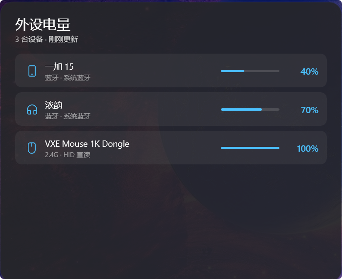
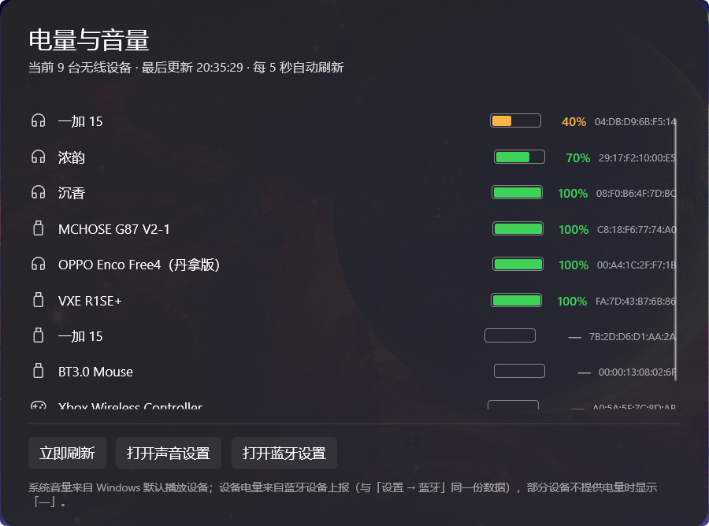
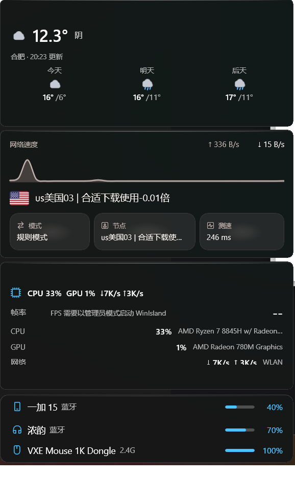
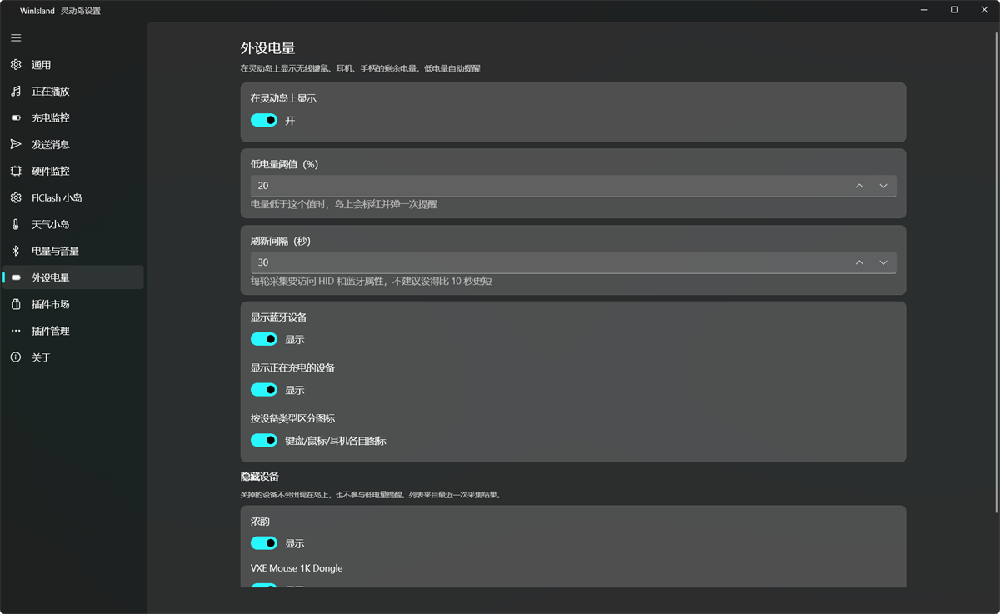

# 外设电量 · WinIsland 插件

在灵动岛上显示键盘、鼠标、耳机、手柄、手机的电量，低电量时提醒你充电。

- 设备支持：支持所有蓝牙设备，和2.4g设备。支持用户自行使用Agent添加新设备适配，欢迎PR。目前支持的2.4g设备主要是VXE蜻蜓家的设备，还有部分迈从设备，计划进一步添加。
- 设备电量列表默认按「电量告急程度排序」，排在列表最上面越需要充电。默认卡片高度自适应，设备数量少卡片体积小，设备数量多会限制卡片大小，保持卡片大小和其他卡片一致。
- 图标丰富。图标按照设备类型给，对设备类型的检测做了相关优化，确保不会识别出错，把键盘识别成鼠标，关联鼠标图标之类。
- 支持隐藏。对于不需要查看的设备，可以在设置选择隐藏显示。也可以关闭`显示正在充电的设备`选项。

预览：



*点击岛体弹出的大卡片：逐行列出设备名、来源标签（蓝牙 / 2.4G · HID 直读）与百分比。*

---

***下面的内容都是AI写的，AI味比较重。关于2.4g设备适配部分建议直接让AI帮你读。***

---

## 为什么选这个，而不是「电量与音量」

社区里已经有一个 [`bluetooth-battery`（市场名「电量与音量」）](https://github.com/luolangaga/WinLandPlugin/tree/main/plugins/bluetooth-battery)。它做得不错，但只覆盖蓝牙，而且有几个严重影响体验的bug。这个插件把这些全部推翻重做：

### 1. 图标丰富，设备类型识别准确

`bluetooth-battery` 按设备名猜类型。碰上中文昵称就没辙 —— 本机的「浓韵」「沉香」是两台头戴耳机，名字里既没有 `headset` 也没有 `耳机`，猜不出来就退回一个通用图标。

本插件优先读蓝牙 **Class of Device**（系统在配对时记录的设备类别），名字只作兜底：

| COD Major | 含义 | 判定 |
| --- | --- | --- |
| 4 | Audio/Video | 耳机 |
| 2 | Phone | 手机 |
| 5 | Peripheral | 看 Minor 位段：键盘 / 鼠标 / 键鼠一体 |

Peripheral 这一段必须**按位取**（`minor & 0x30`），不能直接比相等 —— 本机实测 `minor=32` 是鼠标、`minor=2` 是手柄，写 `minor == 2 or 3 => Mouse` 会把两者都判错。修好之后「浓韵」「沉香」正确落到耳机图标，Xbox 手柄正确落到手柄图标。

认不出类型时给的是**电池图标**，不是电脑图标 —— 外设列表里冒出一台电脑非常误导。

### 2. 支持 2.4G 设备，而且你能自己加

`bluetooth-battery` 完全读不到 2.4G 接收器的电量：这类设备走厂商私有 HID 协议，Windows 的 PnP 电池属性里根本没有它们（实测 USB 2.4G 设备只有 `DEVPKEY_Device_PowerData` 一个字节数组，HID 集合的 50+ 个属性里没有任何 Battery 项）。

本插件为 2.4G 做了可插拔的数据源架构，目前支持 **VXE**（HID 直读）和 **MCHOSE 迈从**（读官方 HUB 缓存）：

```
Sources/Devices/
├── IDeviceSource.cs            接口：实现它就能加一个品牌
├── DeviceSourceRegistry.cs     登记处：加一行就生效
├── DeviceSourceContext.cs      共享上下文（HID 枚举结果、蓝牙扫描结果、日志）
├── BluetoothDeviceSource.cs    蓝牙 / 蓝牙 LE
├── VxeDeviceSource.cs          VXE 2.4G
└── MchoseDeviceSource.cs       MCHOSE 2.4G
```

**新增品牌不需要改采集主流程**，也不用碰界面代码。怎么做见下面「[新增一个 2.4G 品牌支持](#新增一个-24g-品牌支持)」，里面有给 Agent 用的完整工作流。欢迎直接开 PR。

### 3. 蓝牙扫描逻辑更严谨：不重复、不误报

与bluetooth-batter相比：

**坑一：同一台设备出现两次。** 键鼠插着 2.4G 接收器、同时又配对过蓝牙时，两条记录都会进列表（`MCHOSE G87 V2 2.4G` 和 `MCHOSE G87 V2-1`）。本插件把名字归一（去掉连接方式后缀、序号尾巴、非字母数字字符）后合并，并按「2.4G 直读 > 蓝牙 LE > 蓝牙」的优先级留最新那条。

**坑二：配对过但未连接的设备也被显示。** 配对过的蓝牙设备及时没有连接，bluetooth-batter也会显示，并显示电量为100%。本插件专门修正以避免类似问题。

本插件额外查一次 WinRT AEP 的 `System.Devices.Aep.IsConnected`（就是系统「设置 → 蓝牙」里显示「已连接」用的同一个标志），只保留真正在线的设备。

保留条件是 `macConnected || nameConnected` —— 一台设备会有多条服务节点（手机走 BLE 连着、它的经典 Hands-Free 节点却报未连），只按 MAC 过滤会把真正在线的设备误杀。

实测效果：**6 台 → 2 台**，`MCHOSE G87 V2-1`、`VXE R1SE+`、`OPPO Enco Free4（丹拿版）`、`沉香` 这些没开机的全部被正确过滤。
下面是市场上bluetooth-batter的列表显示效果，非常糟糕：



*同一台机器上「电量与音量」的列表：9 台里有 5 台根本没开机，全部固定显示 100%，右边还挂着一列 MAC 地址。*

### 4. 可以隐藏不想看到的设备

设置页里每个采集到的设备都有一个开关。关掉的设备不出现在岛上，也不参与低电量提醒。

典型用法：把手机隐藏掉（手机电量在手机上看得更清楚），或者把常插着电的耳机隐藏掉。有「全部恢复显示」一键还原。

---

## 显示逻辑

- **收起状态**：显示当前电量最告急的那一台（图标 + 名称 + 迷你电量条 + 百分比）
- **悬停展开**：在卡片高度上限内尽可能多地显示，排序仍是电量最告急的在最上面
- **点击岛体**：打开聚光卡，看全部设备的完整列表

悬停展开后的样子（岛体底部那张卡，最下面三行就是外设电量，首行与展开行同款）：



*鼠标悬停展开后的岛体。最下面三行就是外设电量卡片 —— 一加 15 40%、浓韵 70%、VXE Mouse 1K Dongle 100%，按告急程度排序。*

首行与下面的每一行用的是同一个 `DeviceRow`：字号（14 / 12 / 13）、图标位宽（20）、电量条宽度（46）、百分比列宽（36）全部一致。展开时首行只是多长出「来源标签」（2.4G / 蓝牙 / 蓝牙 LE），字号不变。

行高 28、行距 4（净间距 32），字号反而比 13 大了一号，观感更紧凑。

行数与卡片高度联动：视图按实际能塞下的设备数算出 `DesiredExpandedHeight`，插件把它同步给宿主 `ExpandedSize`，设备多卡片就长高、设备少就变矮。

### 高度上限为什么是 152

对照同机已装的三个官方插件（用 IL 常量扫出来的真实值）：

| 插件 | CompactSize | ExpandedSize |
| --- | --- | --- |
| 硬件监控 | 250 × 40 | **420 × 152** |
| 天气小岛 | 250 × 40 | 420 × 140 |
| FlClash 小岛 | 240 × 40 | 460 × 200 |

所以本插件取 `MaxExpandedHeight = 152`，与「硬件监控」齐平。超过这个值，卡片会比同屏邻居高出一大截，把整个展开队列撑歪。

`MaxRows` 由上限反算：`(152 - 5 - 5 - 28 - 8 + 4) / (28 + 4) = 3` 行 → 加上首行共显示 4 台。

---

## 数据来源

| 设备 | 通道 |
| --- | --- |
| 蓝牙 / 蓝牙 LE 设备 | Windows PnP 电池属性（`{104EA319-6EE2-4701-BD47-8DDBF425BBE5} 2`），涵盖 `BTHLE\DEV_*` 与 Hands-Free AG 音频设备 |
| VXE 2.4G 接收器 | HID 厂商通道 `UsagePage 0xFF04` + `HidD_GetFeature(0x06)` |
| MCHOSE 2.4G 键盘 | MCHOSE HUB 的本地缓存 `%APPDATA%\MCHOSEHUB\files\config\mc_main_store_key.json` |

> MCHOSE 官方驱动会以管理员权限独占键盘的厂商 HID 通道，插件侧无法直连读取，因此改读它自己写入的缓存。
> 想拿到最新数值，请让 MCHOSE HUB 在后台运行；关掉它以后数值会停在最后一次读到的值，界面上会标出来源。
> 键盘没开机时 HUB 会把 `batteryLevel` 写成字符串 `"breakConnect"`，插件识别为非数字并跳过，不会显示假电量。

---

## 新增一个 2.4G 品牌支持

> **给用户**：这一段可以直接交给 Agent 做。把下面「给 Agent 的任务说明」整段复制给它就行，它会自己完成探测、实现、测试。
> 也可以自己照着手写 —— 只需要一个文件 + 一行登记。

### 三步概要

1. 在 `Sources/Devices/` 下新建 `<品牌>DeviceSource.cs`，实现 `IDeviceSource`
2. 在 `Sources/Devices/DeviceSourceRegistry.cs` 的 `All` 数组里加一行
3. `dotnet build -c Release -t:Rebuild`，重启 WinIsland，看插件日志确认读到电量

接口只有两个成员：

```csharp
internal interface IDeviceSource
{
    string Brand { get; }                                   // 日志里的品牌名
    List<DeviceBattery> Collect(DeviceSourceContext context); // 采一轮
}
```

`DeviceSourceContext` 提供三样东西：

| 成员 | 用途 |
| --- | --- |
| `HidInterfaces` | 本轮枚举到的全部 HID 集合（`Path` / `VendorId` / `ProductId` / `UsagePage` / `Usage` / `InputLength` / `OutputLength` / `FeatureLength` / `ProductName`）。第一次访问才真正枚举，多个品牌共用同一份 |
| `Bluetooth` | 本轮蓝牙扫描结果（`Succeeded` / `Devices`，每台含 `Mac` / `Name` / `Connected` / `CodMajor` / `CodMinor`） |
| `Info` / `Debug` / `Warn` | 写日志，会进 `%LOCALAPPDATA%\WinIsland\logs\plugin.peripheral-battery.log` |

写实现时的四条硬要求：

1. **`Collect` 不许抛异常**（外面仍会包 try/catch，但自己挡住更好）；
2. **读不到就返回空列表**，不要返回电量为 `null` 的占位项 —— 那会在界面上显示一台没有数字的设备；
3. **`Id` 必须稳定**（同一台设备每次刷新都一样），隐藏设备、低电量去重都靠它；
4. **`Name` 用产品名**，别带 "2.4G" 之类连接方式后缀 —— 去重逻辑按名字把同型号的蓝牙与 2.4G 记录合并成一条。

### 给 Agent 的任务说明

```text
任务：为 WinIsland「外设电量」插件（peripheral-battery）新增一个 2.4G 外设品牌支持。

项目根目录：<peripheral-battery 的路径>
需要读的文件：
  - Sources/Devices/IDeviceSource.cs          接口定义
  - Sources/Devices/DeviceSourceContext.cs    能拿到什么
  - Sources/Devices/VxeDeviceSource.cs        范例：HID Feature 直读
  - Sources/Devices/MchoseDeviceSource.cs     范例：读厂商驱动缓存
  - Native/HidNative.cs                       HID 枚举与 Feature 读取的现成实现
  - README.md 的「新增一个 2.4G 品牌支持」章节

按下面五步做，每步都要有实测证据再进下一步。

【第 1 步 · 摸清接收器暴露了哪些 HID 集合】
先让用户把设备开机、把接收器插上。然后枚举 HID，重点看目标 VID/PID 命中的每一条
接口的 UsagePage / Usage / InputLength / OutputLength / FeatureLength / ProductName。

常见形态：
  · UsagePage 0xFF00~0xFFFF 是厂商自定义集合，电量通常在这里
  · UsagePage 0x0001 + Usage 0x0002 是鼠标、0x0006 是键盘 —— 这些是标准集合，
    通常读不到电量，别在它们身上浪费时间
  · FeatureLength 为 0 表示这条接口不支持 Feature 报告，只能走 Input/Output 通道

【第 2 步 · 判断是 Feature 直读还是别的路子】
优先试 Feature 报告：对每条厂商集合调 HidD_GetFeature，把 reportId 从 0x00 扫到 0xFF，
记录哪些 reportId 返回了数据、返回的字节序列长什么样。
  · 有响应、且某个字节稳定落在 0~100 之间 → 大概率就是电量。多试几次确认稳定，
    并让用户在设备上改变电量（或换一台同型号）交叉验证
  · 全部无响应、或恒返回同一帧与发送内容无关 → 这条通道读不了，见下面第 3 步

【第 3 步 · 直读失败时的退路（按优先级）】
  a. 厂商官方驱动是否把状态写进本地文件？搜 %APPDATA% 与 %LOCALAPPDATA% 下该品牌的目录，
     找 .json / .db / .cfg，看有没有 battery / level / 电量 之类的字段。
     MCHOSE 就是这么做的（%APPDATA%\MCHOSEHUB\files\config\mc_main_store_key.json）。
  b. 官方驱动是否在跑一个本地 HTTP 服务？用 netstat 看它的监听端口，试 GET 接口。
  c. 都没有 → 在 README 里如实写明这个品牌读不到，不要伪造数据。

【第 4 步 · 写实现】
新建 Sources/Devices/<品牌>DeviceSource.cs，照 VxeDeviceSource 的结构写：
  · 从 context.HidInterfaces 里按 VendorId/ProductId 过滤出自己的接收器
  · 再按 UsagePage 精确挑出能读电量的那一条（同型号接收器常有 8 条接口，
    只有 1 条能读，不按 UsagePage 过滤会读到空）
  · 用 context.Debug 打出"命中几条 / 可用通道几条"，方便以后排查
  · 电量越界（>100）要跳过并记日志，不要直接信
然后在 DeviceSourceRegistry.All 里加一行。

【第 5 步 · 验证】
  · dotnet build -c Release -t:Rebuild（必须带 -t:Rebuild，增量构建会跳过复制）
  · 关掉 WinIsland 再启动（否则 DLL 被占用，报 MSB3027）
  · 看 %LOCALAPPDATA%\WinIsland\logs\plugin.peripheral-battery.log，
    确认出现 "· <设备名> = <电量>%（2.4G / <你的 Source>）"
  · 让用户肉眼确认岛上的卡片
  · 拔掉接收器，确认设备从列表里消失（不会残留一条假记录）

【提交 PR】
在 README 的「已支持设备」表格里加上这个品牌，然后开 PR。PR 说明里请写：
  · 设备型号与 VID/PID
  · 数据是怎么读到的（Feature 报告第几字节 / 哪个缓存文件的哪个字段）
  · 你实测到的日志片段
```

### 已支持设备

| 品牌 | 型号 | 读取方式 |
| --- | --- | --- |
| VXE | Mouse 1K Dongle（VID `3554` / PID `F58E`） | HID Feature，reportId `0x06`，`byte[3]` |
| MCHOSE 迈从 | G87 V2 2.4G（VID `3837`） | HUB 缓存 `webIndexList[*].batteryLevel` |
| 蓝牙 | 任意（耳机 / 手机 / 手柄 / BLE 键鼠） | PnP 电池属性 + AEP 连接状态过滤 |

---

## 设置项

设置页在「WinIsland 设置 → 外设电量」：



*设置页：显示开关、低电量阈值、刷新间隔、蓝牙 / 充电中设备开关、类型图标、逐个隐藏设备。*

- 是否在灵动岛上显示
- 低电量阈值（默认 20%）
- 刷新间隔（默认 30 秒）
- 显示 / 隐藏蓝牙设备
- 显示 / 隐藏正在充电的设备（默认显示）
- 按设备类型区分图标
- 逐个隐藏指定设备 + 全部恢复显示
- 立即刷新 / 发送一条测试提醒

## 与其它插件共存

小岛常驻位由 `Priority`（本插件默认 45）决定，不跟「硬件监控」抢那一格；展开时靠 `ExpandedPriority = 200` 排到最前，所以**鼠标一悬停，第一张卡就是外设电量**。

想让它常驻小岛，把 `plugin.peripheral-battery.priority` 调到比硬件监控更高即可。

---

## 构建

```powershell
$env:DOTNET_ROOT = "$env:USERPROFILE\.dotnet"
& "$env:USERPROFILE\.dotnet\dotnet.exe" build -c Release -t:Rebuild
```

必须带 `-t:Rebuild`：增量构建有时会跳过复制，DLL 时间戳不变、跑的还是旧版本。

或直接跑 `rebuild.ps1`（会先关掉 WinIsland 释放文件锁，编译后自动重启并打印插件日志尾部）：

```powershell
powershell.exe -NoProfile -ExecutionPolicy Bypass -File .\rebuild.ps1
```

构建产物会自动复制到 `%LOCALAPPDATA%\Programs\WinIsland\plugins\peripheral-battery\`，重启 WinIsland 生效。

## 调试

插件日志：`%LOCALAPPDATA%\WinIsland\logs\plugin.peripheral-battery.log`

日志里会打出每台设备最终采用的图标，便于核对类型判定：

```
· 浓韵 = 70%（蓝牙 / 系统蓝牙） [图标 Headset U+E7F6]
· VXE Mouse 1K Dongle = 100%（2.4G / HID 直读） [图标 Mouse U+E962]
```

视图侧还有一个 `Diagnose` 钩子，宿主每次要求展开/收起都会记一行：

```
morph → 1（333ms，2 台，高 74）
```

这是确认「卡片真的被宿主显示了、按几台设备展开、总高多少」最可靠的手段。

## 实测记录（本机 2026-11-11 21:00）

| 设备 | 电量 | 通道 | 图标 |
| --- | --- | --- | --- |
| 一加 15 | 40% | 蓝牙（Hands-Free） | 手机 U+E8EA |
| 浓韵 | 70% | 蓝牙（Hands-Free） | 耳机 U+E7F6 |
| VXE Mouse 1K Dongle | 100% | 2.4G HID 直读 | 鼠标 U+E962 |

被正确过滤掉的（已配对但没开机）：`MCHOSE G87 V2-1`、`VXE R1SE+`、`OPPO Enco Free4（丹拿版）`、`沉香`。

界面验证（UIA 读取真实布局，屏幕 125% 缩放）：

```
展开态：浓韵              rect=69,1353 35x24   蓝牙  rect=112,1355   70%  rect=523,1354 45x22
        VXE Mouse 1K Dongle rect=69,1398 172x24 2.4G  rect=250,1400   100% rect=523,1399 45x22
```

两行百分比都落在 `x=523 宽 45` → 右边缘同为 568，右对齐一致；名称左边缘同为 69；行距 `45px ÷ 1.25 = 36 DIP`。

聚光卡（`560×460` DIP）图标位 `Width=26` 从 `978.5` 起算，文字从 `1022` 开始 → 图标右边距 **8.8 DIP**。

---

## 权限与数据

- **网络**：完全不访问网络
- **文件**：只读 `%APPDATA%\MCHOSEHUB\files\config\mc_main_store_key.json`（MCHOSE 键盘电量）；其余数据全部来自 Windows API
- **管理员权限**：不需要
- **设置**：只用插件自己的设置键（`peripheral-battery.*`）

## 许可

MIT
